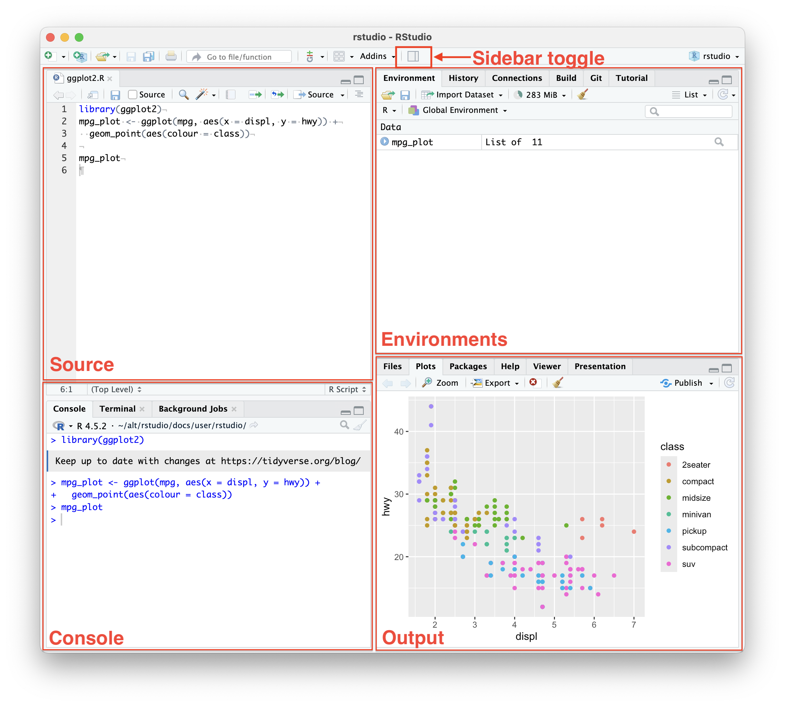

This introductory lesson focuses on the working environment: **where code runs, where commands are saved, and how RStudio organizes work within a project**.

::: {.callout-warning title="Learning takes practice"}
It is normal if some of this feels difficult to understand or remember. We learn by working through unfamiliar ideas. You will use these tools repeatedly in the following lessons, which will help you remember them.
:::

## RStudio as a working environment

**RStudio** is an integrated development environment: an application for writing and running code, working with projects, inspecting objects and plots, reading documentation, and managing files.

R and RStudio are different tools. **R** is both a programming language and the program that executes code written in that language. RStudio provides an interface for working with R.

Think of R as an engine and RStudio as its control panel. The panel helps you operate the engine, but does not replace it.

RStudio also includes tools for Python, the terminal, Git, document publishing, and other tasks.

## The RStudio window

The RStudio window is usually divided into four panes. Each pane can contain several tabs.



*A typical four-pane layout: Source at the top left, Console at the bottom left, Environment at the top right, and Files, Plots, and Help at the bottom right.*

| Pane or tab | What it contains |
|----|----|
| **Source** | Open scripts and documents, where you write and save code |
| **Console** | Commands being executed, messages, errors, and text results |
| **Environment** | Objects created during the current R session |
| **History** | Previously executed commands |
| **Files** | Files and folders in your current location |
| **Plots** | Plots you have created |
| **Help** | Documentation for functions and packages |
| **Viewer** | HTML documents and other web content |

The Source pane may be hidden when no script is open. It appears when you create or open a code file. We will explore these panes in the examples below.

::: {.callout-note title="Pane and tab layout"}
You can rearrange the panes and choose which tabs they contain through **Tools → Global Options → Pane Layout** or **View → Panes → Pane Layout**.
:::

## RStudio settings

Global options apply to RStudio and the projects you work on.

### Opening global options

- Use **Tools → Global Options**.
- On macOS, you can also press `Cmd + ,`.

Start with settings that affect the appearance of the application:

| Setting                                    | Location in Global Options |
|--------------------------------------------|----------------------------|
| RStudio theme, editor theme, and font size | **Appearance**             |
| Arrangement of panes and tabs              | **Pane Layout**            |

Adjust these to suit your preferred working style. We will introduce other settings alongside the relevant features.

## The console and your first command

You can start working in the console as soon as RStudio opens. The `>` prompt means that R is ready to receive a command.

Try a simple expression:

``` r
2 + 2
```

Press **Enter**. R prints:

``` text
[1] 4
```

`[1]` indicates the position of the first element printed on that line. The result of the calculation is `4`.

This illustrates the basic cycle of interactive work:

1.  R receives a piece of code.
2.  It parses the expression.
3.  It executes the command.
4.  It returns a result, message, or error.

::: {.callout-note title="What is an R session?"}
An R session is the period during which an instance of R is running, from its start or restart until it closes. During a session, R keeps objects and other working state in memory. RStudio also tracks the commands you execute.
:::

The console connects you to the current R session. You can type commands directly, send them from a script, or run them from a document's code chunks. R performs the calculations; the console shows this interaction.

If you enter an incomplete expression, such as one with an unclosed parenthesis, the prompt may change from `>` to `+`. R is waiting for the rest of the expression.

Use `Ctrl + L` to clear the console display. This does not undo calculations or delete objects. Press **Esc** to cancel an incomplete command or interrupt a running calculation.

## RStudio projects

When an analysis involves related files and repeated work, organize it as a **project**.

A project is a folder containing the code, data, results, and other materials for one piece of work. A `.Rproj` file tells RStudio which folder is the project root and stores project settings.

A project and a session are different concepts. A project organizes files on disk; a session describes the current state of the running R process.

Create a project through **File → New Project**. You can create a new folder or turn an existing folder into a project.

To reopen it, double-click its `.Rproj` file, or use **File → Open Project...** or **File → Recent Projects**.

::: {.callout-note title="Project settings"}
Open **Project → Project Options** to change settings for the current project. These can override some global options. On macOS, the shortcut is `Shift + Cmd + ,`.
:::

Projects help you:

- Keep unrelated work separate.
- Switch between tasks.
- Move a complete analysis between locations.
- Restore a useful working context.

::: {.callout-important title="Reproducibility within a project"}
A `.Rproj` file does not record your input data or lock package versions. Keep the required code and supporting files with the project so that the analysis can be run again.
:::

### Files within a project

RStudio works with more than R scripts. A project may contain:

- **Project file:** `.Rproj`, the settings and entry point for an RStudio project.
- **Code:** `.R` scripts, as well as `.cpp`, `.py`, and other source files.
- **Documents combining text and code:** `.qmd` for Quarto, or `.Rmd` for R Markdown. This course uses `.qmd`. See [R Markdown and Quarto](#r-markdown-quarto).
- **Rendered documents:** `.html`, `.docx`, or `.pdf`.
- **Data and images:** `.csv`, `.tsv`, `.xlsx`, `.png`, `.jpg`, and other formats.
- **Session files:** `.RData` for saved objects and `.Rhistory` for command history. See [session files](#session-files).

::: {.callout-note title="File extensions identify file types"}
An extension is the part of a filename after its final dot. It helps RStudio and other applications identify the file's purpose and how to process it.
:::

::: {.callout-note title="Text encoding"}
Encoding settings are available under **Tools → Global Options → Code → Saving**. You usually do not need to change them, but they can help if non-English characters display incorrectly. UTF-8 is a useful default for sharing text files.
:::

## Scripts and the Source pane

You can enter commands in the console, but a script—a plain-text file with the `.R` extension—is a better place to save a sequence of steps.

A new script initially exists only as an open editor tab. After you save it, it has a filename and appears in its folder in the Files tab. An asterisk `*` next to the tab name indicates unsaved changes.

Press **Ctrl + Enter** on Windows/Linux or **Cmd + Enter** on macOS to execute selected code. If nothing is selected, RStudio sends the current line to the console. You can select one line, several lines, or part of an expression.

::: {.callout-note title="Editor settings"}
Use **Tools → Global Options → Code** to configure the editor. **Editing**, **Display**, and **Completion** control editing behavior, code display, and autocomplete.
:::

::: {.callout-important title="Scripts and the console have different roles"}
The console is useful for quick experiments and shows the current interaction with R. A script saves a sequence of commands that you can read, edit, and run again.
:::

### Comments

In R code, `#` starts a comment outside a quoted string. The rest of that line is not executed:

``` r
# This is a comment
2 + 2
```

Comments explain code and can temporarily disable lines. Use **Ctrl + Shift + C** on Windows/Linux or **Cmd + Shift + C** on macOS to comment or uncomment selected lines.

## R sessions: objects and command history

Results can appear in different parts of RStudio:

- `2 + 2` prints a number in Console.
- `x <- 2` creates an object that appears in Environment.
- `View(iris)` opens a data viewer tab.
- `plot(iris)` displays a plot in Plots.
- `?plot` opens documentation in Help.

::: {.callout-note title="Code and results can appear in different panes"}
Code stays in Source, runs in the R session, and produces results in Console, Environment, Plots, Help, or a data viewer, depending on the command.
:::

::: {.callout-tip title="Demonstration: data, plots, and help" collapse="true"}
R includes built-in datasets such as `iris`, so you can experiment without loading a file.

Type the object's name to print the table in the console:

``` r
iris
```

For larger tables, open the data viewer instead:

``` r
View(iris)
```

Pass the same dataset to a plotting function:

``` r
plot(iris)
```

The plot appears in Plots. Here, R chooses a display suitable for a table with several variables. The plot belongs to the current session; saving `plot(iris)` in a script lets you recreate it.

Use a question mark to open a function's documentation:

``` r
?plot
```

Two question marks perform a broader search through the installed help:

``` r
??scatterplot
```
:::

### Environment

The following code creates objects `x` and `y`:

``` r
x <- 2
y <- 3
```

Their names and values appear in Environment after you run the code.

::: {.callout-note title="Assignment operators"}
Use `<-` to assign a value to a variable. R also permits `=` for assignment in many contexts. In this course, we use `<-` for assignment and `=` for named function arguments, such as `mean(iris$Sepal.Length, na.rm = TRUE)`. Use `==` to compare values.
:::

Refer to a saved object by its name:

``` r
x
```

``` text
[1] 2
```

While `x` exists in the session, R recognizes it even when you run code from another file. This is convenient, but can hide mistakes. A script that uses `x` without creating it may work only because an old object is still in Environment. After restarting R or moving to another computer, it may fail with `object 'x' not found`.

You can remove individual objects or clear the environment with the broom button. Clearing Environment does not change your saved script.

### History

History contains commands sent to R.

Saving a command in a script does not add it to History; executing it does. Commands typed directly in the console also appear there, even if you never save them in a script.

History helps you recover recent experiments, but does not replace organized code. It mixes successful commands, errors, and temporary checks. Press the **Up arrow** in the console to browse previous commands.

### `.RData` and `.Rhistory` {#session-files}

When closing a session, RStudio may offer to save the workspace. These files are stored on disk:

- `.RData` stores objects from Environment.
- `.Rhistory` stores command history.

If restoration is enabled, reopening a project can reload objects from `.RData` and commands from `.Rhistory`.

Automatic restoration can be convenient, but a large `.RData` file may slow startup and restore objects whose origin is unclear from the script. Starting with an empty Environment helps you check that your saved code creates everything it needs.

::: {.callout-note title="Saving and restoring sessions"}
Settings for restoring `.RData`, saving the workspace, and saving command history are under **Tools → Global Options → General → Basic**. Some can also be changed for an individual project through **Project → Project Options**.
:::

::: {.callout-tip title="Checking reproducibility" collapse="true"}
Try **Restart R → Run All** with workspace restoration disabled. Restarting begins a fresh session; running the saved script recreates its objects. If the script works from a clean session, it does not depend on objects left over from earlier work.
:::

## R Markdown and Quarto {#r-markdown-quarto}

R Markdown (`.Rmd`) and Quarto (`.qmd`) create reproducible documents that combine explanations, code, and results. Like Jupyter notebooks, they let you accompany calculations with text, tables, and plots.

This course uses **Quarto**. Create a document through **File → New File → Quarto Document...**. You may encounter older R Markdown files, created through **File → New File → R Markdown...**.

**Render** in Quarto and **Knit** in R Markdown execute code, insert results, and produce an output file such as HTML, Word, or PDF. You can rebuild the document when its code or data changes. PDF output requires additional software.

## Keyboard shortcut reference

::: {.callout-note title="Viewing and changing shortcuts"}
Open **Help → Keyboard Shortcut Help**, or press **Alt + Shift + K** on Windows/Linux or **Option + Shift + K** on macOS. Customize shortcuts through **Tools → Modify Keyboard Shortcuts**. You do not need to memorize them all immediately.
:::

### Essential shortcuts

| Action | Windows/Linux | macOS |
|----|----|----|
| Save the active document | `Ctrl + S` | `Cmd + S` |
| Run the current line or selection | `Ctrl + Enter` | `Cmd + Enter` |
| Move focus to Source | `Ctrl + 1` | `Ctrl + 1` |
| Move focus to Console | `Ctrl + 2` | `Ctrl + 2` |
| Interrupt a calculation or cancel an incomplete command | `Esc` | `Esc` |

::: {.callout-important title="Finding a command"}
Open the command palette with **Ctrl + Shift + P** on Windows/Linux or **Cmd + Shift + P** on macOS. Start typing an action or setting, such as `pane layout`, `new script`, or `keyboard shortcuts`, and select the matching command.
:::

## Common situations: what to do

### The console shows `+` instead of `>`

R considers the expression incomplete, usually because a parenthesis or quotation mark is missing. Complete the expression or press **Esc** to cancel it.

### An object exists in Environment but not in the script

It was created manually in the console or restored from `.RData`. Add the code that creates it to your script so that your work is reproducible.

### You see an `object not found` error

R does not recognize that name in the current session. Check for typos, capitalization differences, and missing earlier commands that create the object.

### Code is in the script, but nothing happens

Text in the editor does not run automatically. Send the current line or selected code to R to execute it.

### A command is in the script but missing from History

Writing code in a file does not add it to History. History records commands that have been executed.

### A file is missing from the Files tab

The document may not have been saved yet, or it may have been saved outside the project folder. Check the location currently shown in Files.

[Continue to Basic R →](basic_r.qmd)
